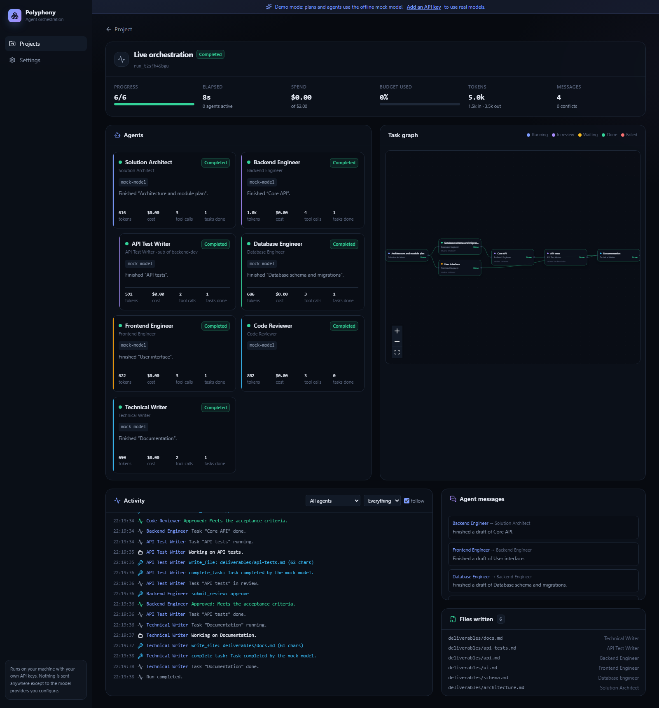

# Polyphony

[](https://github.com/OstvarH/polyphony/actions/workflows/ci.yml)


**Local-first AI agent orchestration.** Describe a software project. Polyphony designs the team that
should build it: the layers, the agents and subagents, the model each one runs on, the tasks, their
dependencies, and who reviews what. You edit and approve the plan, launch it, and watch the agents
work in a live dashboard.

It runs on your machine with **your own API keys**. There is no server to pay for and nothing is sent
anywhere except to the model providers you configure.



## What it does

**An orchestration architect, not a chat box.** From a description such as _“a real estate brokerage
management and accounting system using Laravel, PostgreSQL and React”_, plus an analysis of the
existing codebase, the planner decides:

- which layers the project actually needs (no fixed template);
- the agents, their responsibilities, and subagents where work is separable and cheaper;
- what each role needs, rated 1 to 5 for reasoning, coding, speed and context;
- least-privilege permissions per agent (read, write, run commands, message others);
- tasks small enough for one focused session, with deliverables and acceptance criteria;
- the dependency graph, built for maximum safe parallelism;
- reviewers on risky work, and direct channels between agents that must agree on contracts.

Invalid plans (unknown references, dependency cycles, self-review) are sent back to the planner with
every problem listed until the plan is sound.

**Model selection you control.** Each agent is matched to a model by scoring your catalog against its
requirements under a strategy (_Quality first_, _Balanced_, _Economy_, or your own weights). Nothing
about model preference is hard-coded: ratings and prices are editable, and new models discovered from
a provider are rated by a visible heuristic until you rate them.

**A runtime that keeps control without becoming a bottleneck.**

- Tasks run in parallel as soon as their dependencies are done, one task per agent at a time.
- Agents message each other directly; the orchestrator only handles scheduling, escalations and
  approvals.
- Finished work goes to the task's reviewer (or the subagent's parent). Requested changes send the
  task back with the notes.
- When a provider fails (bad key, outage, rate limit), the agent switches to the next best model.
- Two agents changing the same file in parallel is detected and refused with a hint to coordinate.
- Spending is tracked per call; the run pauses at your budget.
- Agents can escalate decisions to you, and shell commands run only after you approve each one.

**A live dashboard.** Progress, elapsed time, spend against budget, tokens, every agent's status
(idle, working, reviewing, waiting, completed, failed), model, current task and latest activity, the
task graph coloured by status, a filterable activity log, agent-to-agent messages and every file
written. The server and the dashboard rebuild run state from the same event log with the same reducer,
so what you see is exactly what the runtime knows.

## Providers

| Provider                             | How                                                                                                   |
| ------------------------------------ | ----------------------------------------------------------------------------------------------------- |
| Anthropic                            | Official SDK; replays native content blocks unchanged; server-side refusal fallback on current models |
| OpenAI                               | Official SDK, Chat Completions with tool calling                                                      |
| Google Gemini                        | Official `@google/genai` SDK; thought signatures preserved                                            |
| Ollama, LM Studio, vLLM, OpenRouter… | Any OpenAI-compatible endpoint                                                                        |
| Mock                                 | Deterministic offline model, so you can try everything without a key                                  |

## Quick start

Requires Node.js 22.18 or later and pnpm.

```sh
git clone https://github.com/OstvarH/polyphony.git
cd polyphony
pnpm install
pnpm build
pnpm start          # http://127.0.0.1:4317
```

Out of the box Polyphony runs in demo mode on the mock model. Open **Settings**, paste an API key for
any provider, and plans and agents use real models from then on.

For development, `pnpm dev` runs the API (Node's native TypeScript support, with `--watch`) and the
Vite dev server on http://127.0.0.1:5317.

## Security model

- The server listens on `127.0.0.1` only and refuses requests with a foreign `Host` (DNS rebinding) or
  a cross-site `Origin`.
- API keys are encrypted at rest with AES-256-GCM under a per-machine key in `~/.polyphony`, and are
  only ever returned to the UI masked.
- Every path an agent supplies is resolved inside the project workspace; `..`, absolute paths and
  symlinks that lead outside are rejected.
- Shell commands are off by default, need the agent to hold the permission and the run to allow them,
  and then wait for your approval one by one. Secrets are stripped from their environment.

## Architecture

```
src/
  core/        plan schema and validation, execution waves, model selection, run-state reducer
  providers/   neutral chat format + Anthropic, OpenAI-compatible, Gemini and mock adapters
  server/
    planner.ts       the architect: prompt, submit_plan tool, validate-and-repair loop
    analyzer.ts      reads an existing codebase: languages, frameworks, outline, README
    runtime/         orchestrator, agent tool loop, tools, sandboxed workspace
    runs.ts          event numbering, persistence and fan-out to dashboards (SSE)
    store.ts         SQLite via node:sqlite: providers, catalog, projects, plan versions, runs, events
    app.ts           HTTP API
web/           React dashboard (Vite, Tailwind CSS, React Flow)
```

All state lives in a single SQLite file using the engine built into Node, so there is nothing to
install or host. Plans are versioned and never edited in place, so every run keeps the exact plan it
executed.

## Development

```sh
pnpm test        # unit, integration and end-to-end runtime tests (mock provider, no network)
pnpm check       # lint, typecheck, test and build, as CI runs it
```

## Roadmap

- GitHub integration: create a repository and open pull requests from a run.
- Upload reference documents into the planner's context.
- Re-planning during a run: let the orchestrator add, remove and reassign agents as work evolves.
- Per-run cost forecasts before launch.

## License

MIT
